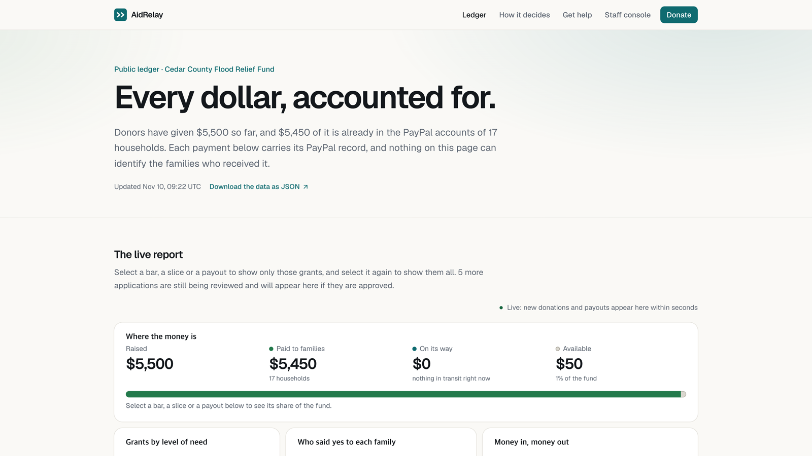

# AidRelay

**Disaster relief cash in minutes, with every dollar on a public ledger.**

AidRelay is an open-source AI case officer for small community relief funds. Donations come in through PayPal. The agent checks each application against a policy the fund's own people wrote, pays the clear cases itself through PayPal Payouts, and hands everything else to a volunteer with its reasons. Every grant appears on a public ledger with its PayPal payout id and no names.

[Live demo](https://aidrelay-545799830947.us-central1.run.app) · [Public ledger](https://aidrelay-545799830947.us-central1.run.app/ledger) · [The policy the agent follows](policy.md) · [Run it yourself](#run-it-yourself)



- **The agent can approve. It can never reject.** A doubtful case goes to a volunteer.
- **Its limits are code, not a prompt.** On its own it pays at most $250 per case, 20 grants an hour and $5,000 a day (the demo's limits; each fund sets its own).
- **A donation pays the families already waiting**, greatest need first.

Sandbox only: the app refuses to start against live PayPal, the demo moves pretend money, and its flood and families are fictional. The hosted demo is shared and may be reset or taken down after the hackathon. Built for the [PayPal AI Hackathon](https://paypalaihackathon.devpost.com/), November 2026.

## Why it exists

AidRelay is for a small US community relief fund (a 501(c)(3) or a fiscally sponsored group) with a PayPal Business account: it raises tens of thousands of dollars after a disaster, gets hundreds of applications in two weeks, and has a handful of volunteers and no engineers.

1. **Public aid takes paperwork.** After Hurricane Helene, FEMA's first payment, Serious Needs Assistance, was $750 and required registering with FEMA first ([NPR, via WUSF, Oct 7 2024](https://www.wusf.org/2024-10-07/fact-checking-falsehoods-about-fema-funding-and-hurricane-helene)).
2. **Small funds run on tools that break under load.** After the July 2025 Chantal floods in North Carolina, Triangle Mutual Aid hit transfer caps on its personal payment app and its donations were held ([Triangle Blog Blog, Jul 17 2025](https://triangleblogblog.com/?p=14242)).
3. **Fast money without a ledger loses trust.** Austin Mutual Aid reported $2.6M raised after the 2021 Texas freeze, and other organizers pointed out that its spreadsheet showed no backup for the numbers ([VICE, Jul 27 2021](https://www.vice.com/en/article/austin-mutual-aid-raised-millions-during-february-2021-texas-storm-freeze-where-is-it-now/)).
4. **Fast, verified cash works, but only at scale.** GiveDirectly sent nearly $12M in $50 payments to 238,153 families within one to two days when SNAP benefits lapsed in November 2025 ([GiveDirectly](https://www.givedirectly.org/snap-response), [Fortune](https://fortune.com/2025/12/24/government-shutdown-snap-payments-givedirectly-nonprofit-food-stamps/)). A five-volunteer flood fund has nothing like that.

### Why PayPal

- A family is paid to an email address. With a PayPal account the money is there within minutes; without one, PayPal holds it until the family claims it.
- A payout nobody claims goes back to the fund by itself after 30 days.
- Every donation and every grant has a PayPal id, and the ledger publishes it, so the fund's books can be checked against PayPal's.

## How it works

```
 Donor ----> /donate (PayPal JS SDK) ----> Orders API create + capture --+
 PayPal Webhooks --> /api/webhooks/paypal (signature verified) ---------+--> Firestore
 Applicant --> /apply (English/Spanish, photos to Cloud Storage) -------+    (fund, donations, cases,
                                                                              payouts, audit log, agent runs)
                                      |
                                      v
   AI case officer (Claude Sonnet 5.5, typed tools)
     wakes on: a new application | a donation | a volunteer's approval | a sweep
     limits:   policy.md, enforced in code
                                      |
                                      v
   Payouts API, one payout per case ----> the family's PayPal account
                                      |
              +-----------------------+------------------------+
              v                                                v
   /ops: volunteers supervise                      /ledger: anyone audits
   (AG Grid queue, activity feed, Ask the ledger)  (AG Studio report)
```

The agent works on events:

- **A new application:** check for duplicates, judge the photos and the story against the policy, then pay, ask the applicant a follow-up question, or hand the case to a volunteer with its reasons.
- **A donation:** pay the families who were waiting for funds, greatest need first, then first come.
- **A volunteer's approval:** pay the approved cases in the same order, or keep them waiting until the fund has the money.
- **A sweep** (`pnpm agent:sweep`, or every 10 minutes on a schedule): pick up anything a lost trigger left behind and check payouts whose PayPal confirmation is late. An idle sweep calls no model.

PayPal's payout confirmations are settled in code, without a model call: success marks the case paid; a failure gives the money back to the fund and sends the case to a volunteer.

### Who decides what

| Claude decides | Code decides |
|---|---|
| Whether the household is eligible, from the photos and the story | The amount: the grant for the level of need plus the household rule, capped |
| The level of need, 1 to 4, and how confident it is | Duplicates: the same photo, address or contact as an earlier case |
| Whether a photo contradicts the story | Whether the home is inside the declared area |
| The reasons, each citing a policy clause | Whether all ten auto-approve conditions hold, and who is paid first when money is short |
| Follow-up questions, in the applicant's language | Every status change, the reservation of funds and the payout itself |

## What is guaranteed

The limits live in [`policy.md`](policy.md), written by the fund's people and published at `/policy`. These hold in code, and each has tests:

- **The agent pays on its own only when all ten conditions of policy P-9 hold**, among them: eligible, at most the auto-approve limit, confident enough, no red flags, a usable photo or document on file, and a second, separate evaluation that agrees. The hourly and daily limits are checked again inside the transaction that records the payout. (`lib/agent/guardrails.ts`, `lib/db/repos/payouts.ts`; `guardrails.test.ts`, `auto-pay-limits.test.ts`)
- **It cannot reject, cannot change a paid case and cannot override a volunteer.** Every status change goes through a state machine per actor. (`lib/agent/transitions.ts`; `transitions.test.ts`)
- **Amounts come from the policy, never from the model.** A volunteer's amount is capped too. (`lib/agent/evaluate.ts`, `lib/agent/policy.ts`; `evaluate.test.ts`, `policy.test.ts`)
- **One payout per case, and no overdraft.** Money is set aside before any payout, and PayPal is given an id tied to the case, so a repeated request cannot pay twice. A payout PayPal did not accept is sent again only by a volunteer, with the same id. (`lib/db/repos/fund.ts`, `lib/db/repos/payouts.ts`; `repos.test.ts`, `payout-retry.test.ts`)
- **Nobody jumps the queue.** The payment order is computed in code and checked again before every payout. (`lib/agent/allocation.ts`; `allocation.test.ts`)
- **The applicant's story is data, not instructions.** It is fenced off in the prompt and scanned for instructions; a hit goes to a volunteer. (`lib/agent/evaluate.ts`, `lib/agent/prompts.ts`; `evaluate.test.ts`)
- **The ledger identifies no one.** Names, addresses, emails, phone numbers and anything about health are kept off it, and documents an applicant sends are shown only to signed-in staff. (`lib/ledger/anonymize.ts`; `anonymize.test.ts`)
- **Everything is on the record.** Every tool call appears live in the staff console, and every change to a case or the fund is written to an audit log with the policy clause it relied on. (`lib/agent/tools.ts`, `lib/db/repos/audit.ts`; `officer.test.ts`)
- **Looking is open, acting is not.** The staff console can be opened by anyone in this demo, with contact details hidden; every action needs a signed-in volunteer. (`lib/ops/auth.ts`, `lib/ops/public-view.ts`; `ops-public-view.test.ts`)

## Built with

- **PayPal:** Orders v2 for donations (create and capture), Payouts v1 for grants, Webhooks (every event signature-verified and handled once), and the JS SDK donate button. The agent's PayPal tools are our own typed functions over REST.
- **Claude:** Sonnet 5.5 runs the case officer and makes the decision on each case; Haiku 5.5 pre-screens photos, runs *Ask the ledger* and screens its questions. Called through the AI SDK (`ai`, `@ai-sdk/anthropic`), with the policy and system prompt cached.
- **AG Grid Enterprise and AG Studio:** the staff queue, the public ledger and the ledger auditor.
- **Next.js 15**, Firestore, Google Cloud Storage, hosted on Cloud Run.

### The ledger and the staff console

- **`/ledger`** is an AG Studio report anyone can open: where the money is, grants by level of need, who approved each family, money in and money out on one timeline, and every grant with its PayPal payout id. Clicking a bar, a slice or a payout filters the whole report. It refreshes every 10 seconds.
- **`/ops`** is where volunteers work: an AG Grid queue grouped by level of need with totals and flags, inline amount edits and bulk approval, each case's photos and the agent's reasons, and a live feed of the agent's tool calls.
- **Ask the ledger** (`/ops/audit`) lets staff ask questions in plain English. An auditor agent answers from the anonymized tables, citing case and payout ids, and AG Studio's own agents add charts to the report. It can read and draw, never approve or pay, and it only answers questions about the ledger.

<details>
<summary>AG Studio APIs used</summary>

**Ledger** (`app/ledger/`)

- Built-in widgets: a stacked column chart of grants by level of need, a donut of who approved each family, and the grant table with a total row.
- Two custom widgets, *Where the money is* and *Money in, money out* (`studio-widgets.tsx`), registered with `createWidgets({ additionalTypes, overrides })`. The first reads `widgetApi.getData(..., { crossFilter: "highlight" })` to show the selected share; the second calls `widgetApi.toggleCrossFilter` when a payout is clicked.
- `studioTheme.withParams` binds the report to the site's light and dark theme; `responsiveLayoutBreakpoints` gives tablet and phone layouts (`studio-layout.ts`).
- Custom cell renderers through the grid override's `createCellRenderer`, value-change flashes, and `localeText` for the page's wording. If Studio fails to load, an error boundary shows the same ledger as plain AG Grid tables.

**Auditor** (`app/ops/audit/`, `lib/ops/`)

- `createAiHarness` with a builder; `directLlmRunner` for our agent and for Studio's built-in `data`, `page` and `widget` agents; `ctx.studio.*` tools, `tools.delegateTo`, `tools.renameThread`; `AgStudioAiModule`; prompt starters; a telemetry observer showing turns, agents, tokens and cost.
- Every agent's turns go through our `AgLlmAdapter` (`claude-adapter.ts`) to `/api/ops/ask`, which streams Studio's events back from Claude Haiku 5.5 (`lib/ops/llm-bridge.ts`). Tool calls run in the browser on the anonymized tables, so the model never sees contact details, and the Anthropic key never leaves the server.
- Every new question is screened on the server first (`lib/ops/ask-guard.ts`); attempts to rewrite the auditor's instructions or off-topic questions get a fixed reply and never reach it.

**Staff queue** (`app/ops/case-grid.tsx`): AG Grid Enterprise row grouping with group totals, the row group panel, the columns and filters tool panels, set and number filters, multi-row selection, inline editing and a custom status bar panel that totals the selected grants.

</details>

## Run it yourself

You need Node 20 or later, pnpm, a PayPal sandbox app, an Anthropic API key and a Google Cloud project. Every application the agent reviews makes real model calls on your Anthropic key.

<details>
<summary>Setting up the PayPal sandbox and Google Cloud</summary>

1. **PayPal:** on developer.paypal.com create a sandbox app and turn on **Payouts** in its features (payouts fail without it). Create sandbox accounts: a business account for the fund with a balance to pay from, a personal account for the donor, and one personal account for each case you want to see paid. Every case needs its own payout email, or the duplicate check sends it to a volunteer.
2. **Webhook:** register `${APP_URL}/api/webhooks/paypal` (a public URL, for example through ngrok) for `PAYMENT.CAPTURE.COMPLETED`, `PAYMENT.PAYOUTSBATCH.*` and `PAYMENT.PAYOUTS-ITEM.*`, and put its id in `PAYPAL_WEBHOOK_ID`.
3. **Google Cloud:** a Firestore database and a Cloud Storage bucket. Credentials come from `gcloud auth application-default login`, or from a key file named in `GOOGLE_APPLICATION_CREDENTIALS`.
4. **The rest of `.env`:** `APP_URL` is where the app is reached, `ADMIN_PASSWORD` is the staff sign-in for `/ops`, and `AGENT_INTERNAL_SECRET` protects the route that wakes the agent.

</details>

```bash
pnpm install
cp .env.example .env                               # PayPal sandbox app, Anthropic key, GCP project and bucket
cp seed/accounts.example.json seed/accounts.json   # your sandbox account emails
pnpm check          # is every service reachable? (PayPal, Payouts, webhook, Firestore, Cloud Storage, Anthropic)
pnpm seed           # the fund and 22 fictional applications, with generated photos
pnpm dev            # http://localhost:3000
```

Then donate on `/donate` as your sandbox donor and run `pnpm agent:sweep` to let the case officer work through the queue. Donations are never seeded, because a PayPal capture needs the donor's approval in a browser. [`seed/README.md`](seed/README.md) describes the seed applications and their photos (generated images of a fictional county, no real people).

**Deploy:** `scripts/deploy-cloudrun.sh` builds the `Dockerfile` and deploys to Cloud Run; `scripts/schedule-sweep.sh` adds the 10-minute sweep with Cloud Scheduler.

**Tests:** `pnpm typecheck && pnpm lint && pnpm test`. About 380 tests run against an in-memory database with PayPal and the model mocked, so they move no money.

## Limits

- **Evidence is a photo and a story, not an identity check.** What the agent can lose is capped instead: the per-payout, hourly and daily limits, one payout per case, and a volunteer for anything that repeats a photo, an address or a contact.
- **PayPal's fees are not on the ledger yet,** so the fund's real PayPal balance is lower than *Available*. A refunded or disputed donation is recorded but not taken out of *Raised*.
- **A payout that fails after PayPal accepted it** (failed, returned, or unclaimed for 30 days) gives its money back to the fund and returns to a volunteer, but cannot be sent again from the console yet. A payout request that times out waits for a volunteer to send it again.
- **The staff console is open to look at in the demo** (`OPS_PUBLIC_VIEW=true`), with contact details hidden, and `/apply` says so before anyone writes anything. A real fund sets it to `false`.

Out of scope on purpose: identity verification, live money, bank verification, multi-tenant sign-in, a mobile app, SMS intake, email or SMS notifications (applicants read messages on their status page) and in-kind logistics.

## License

MIT, see [`LICENSE`](LICENSE).
